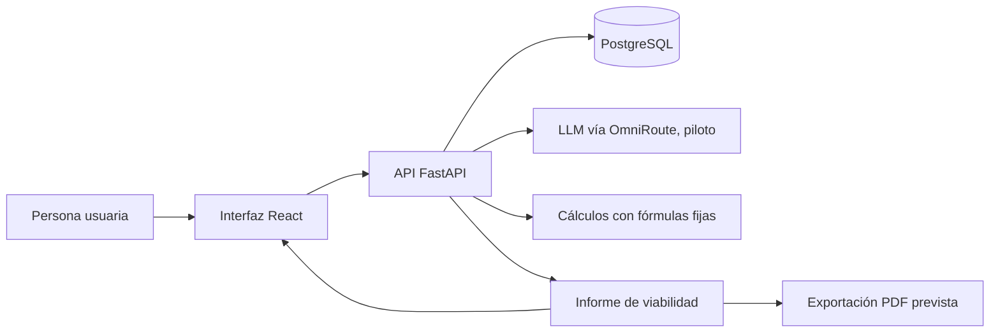

# Arquitectura inicial

> Arquitectura candidata basada únicamente en las tecnologías mencionadas en
> el README. No representa una decisión técnica aprobada ni una implementación.

## Tecnologías mencionadas

- **Interfaz:** React.
- **API:** Python con FastAPI.
- **Persistencia:** PostgreSQL.
- **LLM:** OmniRoute, descrito en el README como piloto.

El repositorio no documenta versiones, alojamiento, proveedor de modelos,
servicio de búsqueda, librerías, costos ni configuración de despliegue.

## Flujo conceptual

El diagrama expresa una propuesta para ordenar los componentes declarados.
Faltan decisiones sobre qué información se guarda, si el acceso al LLM ocurre
por la API, cómo se obtienen los datos de mercado y cómo se genera el PDF.

## Responsabilidad conceptual

| Componente | Responsabilidad propuesta | Incertidumbre |
|---|---|---|
| React | Capturar la idea y mostrar el informe. | Formularios, validaciones, accesibilidad y pantallas pendientes. |
| FastAPI | Recibir solicitudes y coordinar el análisis. | Contratos de API, errores, autenticación y límites pendientes. |
| PostgreSQL | Persistir datos si el producto requiere almacenamiento. | No está definido qué se guarda, por cuánto tiempo ni con qué permisos. |
| OmniRoute / LLM | Apoyar el análisis FODA y la estimación de demanda. | Modelo, costo, latencia, privacidad, límites y salida estructurada pendientes de validar. |
| Cálculos fijos | Calcular costos y punto de equilibrio de forma repetible. | Fórmulas, entradas y casos de prueba pendientes. |
| Informe/PDF | Presentar resultados en los formatos previstos. | Plantilla, trazabilidad y generación del PDF pendientes. |

## Datos y procedencia

La funcionalidad prevista implica que se podrían manejar:

- Descripción de la idea ingresada por la persona usuaria.
- Datos de costos que permitan calcular punto de equilibrio.
- Información de competencia, precios y tendencias.
- Resultados del análisis FODA y estimación de demanda.
- Contenido del informe y su versión PDF.

La lista anterior se deduce de las funciones del README. No se conoce aún el
origen de los datos de mercado, si se almacenarán entradas o informes, ni si
podrían contener datos personales. Todo ello debe decidirse antes de construir
persistencia o integrar proveedores externos.

## Validaciones técnicas necesarias

1. Confirmar que OmniRoute permite el caso de uso, con costos, límites,
   latencia y condiciones de privacidad aceptables.
2. Probar que las respuestas del LLM pueden manejarse en un formato controlado
   y que la interfaz distingue estimaciones de cálculos.
3. Acordar y verificar las fórmulas financieras con casos de referencia.
4. Identificar una fuente de datos de mercado utilizable y documentar su
   cobertura y permisos.
5. Definir qué se persiste y cómo se protege antes de conectar PostgreSQL.
6. Confirmar que generar y presentar el informe cumple el objetivo de menos
   de cinco minutos.

Estas son pruebas propuestas, no validaciones ya realizadas.

## Restricciones y preguntas abiertas

- No hay código en `src/`; el desarrollo debe esperar autorización del docente.
- El uso de datos personales, consentimiento, retención, acceso y eliminación
  no está definido.
- No hay decisiones sobre autenticación, despliegue, monitoreo ni recuperación
  ante fallos.
- Las dependencias externas, licencias y permisos de datos deben verificarse
  antes de depender de ellas.
