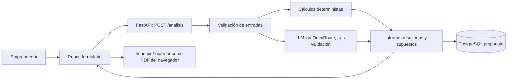

# Arquitectura inicial propuesta

> Diseño candidato; no está implementado. La selección de tecnologías y el
> flujo deben ratificarse. La prueba de viabilidad y el desarrollo requieren la
> autorización docente aplicable.

## Componentes y justificación

| Tecnología | Necesidad del proyecto | Alternativa considerada | Estado |
|---|---|---|---|
| Python + FastAPI | Coordinar cálculos, validación de entradas e integración con el LLM; se propone validar contratos con Pydantic. | Node/Express. La afinidad del equipo con cada opción debe confirmarse. | Mencionada en README; elección por ratificar. |
| React | Construir el formulario y la pantalla del informe. | HTML y JavaScript simple, potencialmente más reducido para una demostración. | Mencionada en README; elección por ratificar. |
| PostgreSQL | Persistencia de informes si se aprueba D6. | SQLite para un MVP con requisitos de persistencia simples. | Mencionada en README; alcance y recurso pendientes. |
| OmniRoute | Proveedor piloto para apoyar FODA y demanda. | Otro proveedor compatible como plan B. | Solo depender de él tras prueba de viabilidad y revisión de privacidad, costo y latencia. |

Las razones de esta tabla son propuestas del paquete de mejoras, no evidencia de
experiencia, disponibilidad, costos o rendimiento verificados por el equipo.

## Flujo conceptual



En la reducción de alcance, D6 podría no aplicarse y el informe existiría solo
en pantalla durante la sesión. La decisión de persistencia aún debe
ratificarse.

## Responsabilidades propuestas

- **React:** recopilar los campos acordados y mostrar errores, cálculos,
  estimaciones, supuestos y avisos.
- **FastAPI:** validar y orquestar la solicitud; exponer un contrato
  documentado.
- **Motor de cálculos:** ejecutar las fórmulas fijas y responder con error
  controlado si el margen no es positivo.
- **Integración de IA:** enviar solo los datos acordados, validar la respuesta
  estructurada y manejar fallos sin perder los cálculos.
- **PostgreSQL:** si se ratifica, guardar la entrada mínima y el informe con
  identificador aleatorio, política de borrado y retención aprobadas.
- **Informe:** diferenciar los cálculos de la estimación generada por IA y
  permitir imprimir desde el navegador.

## Contrato inicial propuesto

- `POST /analisis`: recibe los datos acordados del formulario y devuelve el
  informe en formato JSON.
- `GET /informes/{id}`: recupera un informe solo si la persistencia se ratifica.
- `GET /health`: comprueba disponibilidad del servicio durante desarrollo o
  demostración.

El esquema de solicitud/respuesta, validaciones, estados de error, autorización,
límite de solicitudes y política de acceso quedan por especificar antes de
implementar. Los endpoints son propuesta, no código existente.

## Partes difíciles o inciertas

1. Calidad, formato y consistencia de la salida del LLM.
2. Cumplir la meta de cinco minutos y conocer el costo por informe.
3. Estimar demanda sin datos de mercado independientes; los supuestos deben
   hacerse visibles.
4. Decidir qué datos se guardan y cómo se informan al usuario cuando se envían
   al proveedor externo.
5. Mantener los cálculos reproducibles con entradas y unidades inequívocas.

## Prueba de viabilidad previa propuesta

Realizar únicamente tras autorización docente y fuera de `src/` (por ejemplo,
en `spikes/omniroute/`, si el equipo y el docente autorizan crear esa carpeta).
Usar casos de prueba anonimizados/no sensibles; no colocar credenciales en el
repositorio ni compartirlas en los artefactos de evidencia.

| Prueba | Criterio propuesto | Si falla |
|---|---|---|
| Formato de respuesta para 10 ideas de prueba | Al menos 9 de 10 respuestas cumplen el esquema JSON acordado. | Ajustar instrucciones y validación; repetir la prueba o activar alternativa. |
| Latencia | Mediana de respuesta del LLM ≤ 60 segundos. | Reducir el alcance de la solicitud o evaluar otro modelo/proveedor. |
| Costo | Registrar el costo por análisis y compararlo con OE5. | Evaluar el plan B o reducir llamadas; no fijar precio sin datos. |
| Privacidad | Revisar los términos y el tratamiento de datos del proveedor antes de enviar entradas. | No enviar datos reales y no depender del proveedor hasta resolver la revisión. |

No se han ejecutado estas pruebas y no hay resultado o costo registrado.
Registrar resultados agregados en `docs/07-evidencias/` y
`docs/05-estadistica/resultados.md` cuando existan.

## Dependencias externas y estructura lógica

Dependencias que requieren confirmación: proveedor de LLM, fuente de mercado
para futuras versiones, servicio de alojamiento, base de datos si se ratifica,
librerías de API/interfaz y acceso al repositorio. Proveedor de hosting,
versiones, licencias, costos y disponibilidad no están documentados.

Si y cuando exista autorización docente, la estructura lógica sugerida para
una versión posterior es:

```text
src/
  backend/
    app/ (main.py, calculos.py, ia.py, schemas.py)
    tests/
  frontend/
    src/ (Formulario, Informe)
```

Este árbol es una propuesta futura; `src/` debe continuar vacío hasta recibir
autorización expresa para iniciar el desarrollo.
