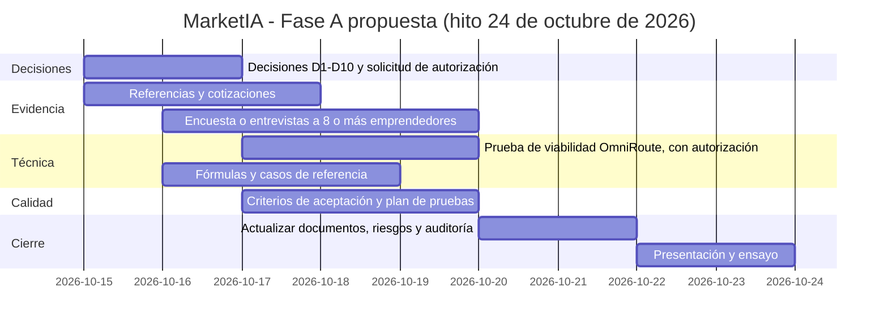

# Plan de desarrollo, Gantt y riesgos

> Borrador de planificación basado en el paquete de mejoras. Las fechas de la
> fase A corresponden a una propuesta para el hito del 24 de octubre de 2026;
> estimaciones y responsables deben ser ratificados por el equipo. Las fechas
> de la fase B no están definidas y dependen de la autorización docente.

## Fase A — planificación y validación

El Gantt expresa fechas propuestas en el paquete; el repositorio no contiene
un acuerdo del equipo que las ratifique. Confirmar disponibilidad y cualquier
cambio de fechas antes de usarlas como calendario comprometido.

| ID | Tarea | Responsable propuesto | Estimación propuesta | Depende de |
|---|---|---|---:|---|
| A1 | Cerrar decisiones y solicitar autorización docente. | Alex Vásquez Pérez | 3 h | Ninguna |
| A2 | Completar referencias y obtener cotizaciones. | Alex Vásquez Pérez | 4 h | Ninguna |
| A3 | Encuesta o entrevistas a 8 o más emprendedores. | Cristián García Bustamante, con Alex | 8 h | A1 |
| A4 | Prueba de viabilidad OmniRoute. | Nelson Zapata Jiménez | 8 h | A1 y autorización docente |
| A5 | Revisar fórmulas y completar 10 casos de referencia. | Nelson Zapata Jiménez, con revisión de Cristián | 4 h | A1 |
| A6 | Criterios de aceptación y plan de pruebas. | Cristián García Bustamante | 5 h | A1 |
| A7 | Actualizar documentos, riesgos y auditoría con evidencia disponible. | Alex Vásquez Pérez | 4 h | A2–A6 |
| A8 | Preparar diapositivas y ensayar. | Alex Vásquez Pérez, con participación de todo el equipo | 6 h | A7 |

Las estimaciones propuestas suman 42 horas para la fase A. No equivalen a horas
registradas ni a disponibilidad confirmada.

## Fase B — desarrollo, solo con autorización

No hay fechas confirmadas para esta fase. No iniciar código en `src/` hasta que
el docente autorice el desarrollo.

| ID | Tarea | Responsable propuesto | Estimación propuesta | Depende de |
|---|---|---|---:|---|
| B1 | Esqueleto FastAPI, contrato OpenAPI y `/health`. | Nelson Zapata Jiménez | 6 h | A4, A5 y autorización docente |
| B2 | Motor de cálculos y pruebas unitarias. | Nelson Zapata Jiménez | 8 h | A5 |
| B3 | Integración con LLM y validación de esquema. | Nelson Zapata Jiménez | 12 h | A4 y B1 |
| B4 | Formulario React con validación. | Cristián García Bustamante | 10 h | B1 |
| B5 | Pantalla de informe que distingue cálculo y estimación. | Cristián García Bustamante | 10 h | B1 |
| B6 | Persistencia mínima con PostgreSQL, solo si se aprueba D6. | Nelson Zapata Jiménez | 6 h | B1 y D6 |
| B7 | Integración de extremo a extremo. | Nelson Zapata Jiménez y Cristián García Bustamante | 8 h | B2–B5 |
| B8 | Pruebas con cinco usuarios y correcciones. | Cristián García Bustamante y Alex Vásquez Pérez | 10 h | B7 y protocolo aprobado |
| B9 | Manual de usuario, informe final y evidencias. | Alex Vásquez Pérez | 10 h | B7 |
| B10 | Medir veinte ejecuciones y analizar resultados. | Nelson Zapata Jiménez y Alex Vásquez Pérez | 6 h | B7 |

Las tareas de la fase B suman **86 horas** según esta tabla (el paquete las
describe aproximadamente como 90 horas). Ambas cifras son estimaciones
propuestas, no compromisos confirmados. No consta cuántas horas semanales puede
aportar cada integrante; completar esa disponibilidad antes de afirmar que el
trabajo cabe en cuatro semanas.

## Tareas que pueden bloquear al equipo

| Tarea bloqueante | A quién o qué bloquea | Respuesta propuesta |
|---|---|---|
| A1 / autorización docente | A4 y toda la fase B. | Solicitar autorización; mientras tanto, limitarse a documentación y casos de referencia no sensibles. |
| A4 / prueba de OmniRoute | B3 y análisis con IA. | Si no cumple criterios, evaluar el plan B antes de depender del proveedor. |
| B1 / contrato de API | B3, B4 y B5. | Acordar el contrato primero y usar respuestas simuladas para avanzar en componentes independientes. |
| B7 / integración | B8, B9 y B10. | Integrar una versión mínima temprano y registrar defectos. |

## Riesgos y mitigaciones

Probabilidades e impactos se presentan como evaluación preliminar del paquete;
el equipo debe revisarlos, asignar seguimiento y documentar cualquier cambio.

| ID | Riesgo | Probabilidad / impacto propuestos | Señal temprana | Mitigación | Plan B | Responsable propuesto |
|---|---|---|---|---|---|---|
| R1 | La IA devuelve salidas inválidas, inconsistentes o engañosas, o excede el tiempo meta. | Alta / alto | Fallos en la prueba de viabilidad. | Validar esquema, reintentar según regla acordada, etiquetar estimaciones, mostrar supuestos y probar casos. | Cambiar proveedor/modelo o mostrar solo cálculos cuando la IA no esté disponible. | Nelson Zapata Jiménez |
| R2 | El alcance supera tiempo y capacidad disponibles. | Alta / alto | Tareas atrasadas más de dos días. | Ratificar MVP, estimar tareas y revisar avance semanalmente. | Aplicar el recorte del 40 % si el equipo lo aprueba. | Alex Vásquez Pérez |
| R3 | Falta evidencia o participantes para validar el problema. | Media / alto | Menos de ocho respuestas al 19 de octubre, fecha propuesta. | Iniciar el protocolo tras aprobarlo y registrar el método. | Entrevistas presenciales a cinco usuarios, si el equipo y el docente aceptan el cambio de muestra. | Cristián García Bustamante |
| R4 | Una persona clave no está disponible. | Media / alto | Ausencia o retraso. | Documentar fórmulas, contratos, decisiones y pruebas; aplicar respaldos cruzados acordados. | Aplicar el recorte aprobado y reasignar trabajo. | Alex Vásquez Pérez |
| R5 | La autorización docente no llega a tiempo. | Media / alto | Sin respuesta para el 17 de octubre, fecha propuesta. | Solicitar por escrito la autorización para la prueba y el desarrollo por separado. | Continuar solo con documentación y planificación; no iniciar código en `src/`. | Alex Vásquez Pérez |

Los riesgos R3 y R5 incluyen fechas propuestas por el paquete. Confirmarlas
con el docente y el equipo; no implican que la encuesta, solicitud o respuesta
ya hayan ocurrido.

## Revisión de avance

Se propone una revisión semanal de 30 minutos y un seguimiento de tareas con
responsables y estimaciones. El día, hora, canal y tablero deben acordarse; no
constan todavía en el repositorio.
