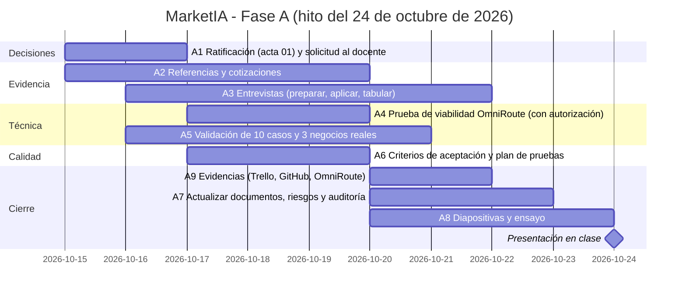
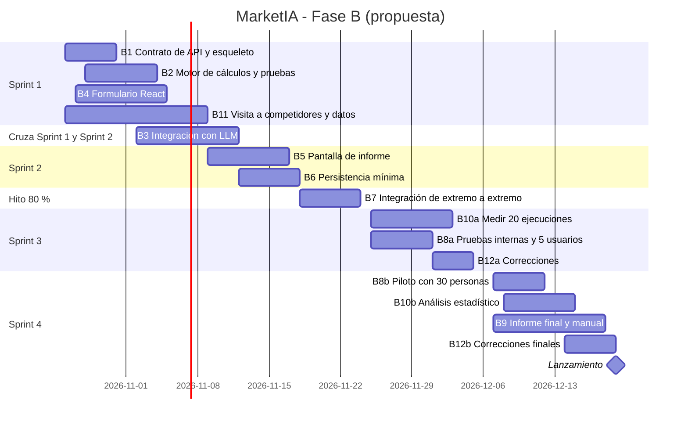

# Plan de desarrollo, Gantt y riesgos

> Las fechas y tareas combinan el cronograma del **informe final**
> ([PDF](../01-proyecto/MarketIA_informe_final.pdf)) con el plan del paquete de
> mejoras. Son **propuestas listas para ratificar** en el
> [acta 01](../actas/acta-01-ratificacion.md). Las horas y reuniones están en
> [`equipo/roles-y-acuerdos.md`](../../equipo/roles-y-acuerdos.md).

## 1. Hitos

| Fecha | Avance | Qué debe estar listo (según el informe) |
|---|---|---|
| Sábado 24 de octubre de 2026 | 40 % | Informe mejorado, diseño del sistema, prototipo de pantallas, OmniRoute configurado, prueba con un caso de ejemplo, costos calculados y presentación en clase |
| Martes 24 de noviembre de 2026 | 80 % | Módulos de datos, IA y costos integrados; pantalla conectada; pruebas internas; datos reales de competidores |
| Sábado 19 de diciembre de 2026 | 100 % | Prueba piloto con 30 personas, análisis estadístico, correcciones, informe final y lanzamiento |

Metas intermedias del informe: 13 nov (Meta 1), 20 nov (Meta 2), 8 dic
(Meta 3), 12 dic (Metas 4 y 5). Ver [`objetivos.md`](../02-requisitos/objetivos.md).

## 2. Fase A: planificación y validación (15 al 24 de octubre)

| ID | Tarea | Responsable | Horas | Depende de |
|---|---|---|---:|---|
| A1 | Reunión de ratificación, acta y solicitud al docente | Alex | 3 | n/a |
| A2 | Verificar referencias y obtener 2 cotizaciones | Alex | 4 | n/a |
| A3 | Entrevistas: preparar, aplicar a 8 a 10 emprendedores y tabular | Cristián 6, Alex 4 | 10 | A1 (protocolo) |
| A4 | Prueba de viabilidad de OmniRoute (10 ideas, latencia, costo) | Nelson | 8 | A1 y autorización docente |
| A5 | Validación independiente de los 10 casos y de 3 negocios reales | Nelson 4, Cristián 2 | 6 | A1 |
| A6 | Criterios de aceptación y plan de pruebas | Cristián | 5 | A1 |
| A7 | Actualizar documentos, riesgos y auditoría con la evidencia obtenida | Alex | 4 | A2 a A6 |
| A8 | Diapositivas y ensayo | Alex 2, Nelson 2, Cristián 2 | 6 | A7 |
| A9 | Capturas y evidencias (Trello, GitHub, OmniRoute) | Alex 1, Nelson 1, Cristián 1 | 3 | A1 |

**Horas por persona (tareas):** Alex 18, Nelson 15, Cristián 16 (total 49).
Con 3 horas de reuniones por persona en la fase A: 21, 18 y 19 horas.

## 3. Fase B: desarrollo (26 de octubre al 19 de diciembre)

Empieza **solo con autorización docente** (D10). `src/` permanece vacío hasta
entonces. Cuatro sprints de dos semanas:

| Sprint | Fechas | Objetivo |
|---|---|---|
| 1 | 26 oct a 6 nov | Contrato de API, motor de cálculos con pruebas, formulario |
| 2 | 9 a 20 nov | Integración con el LLM, pantalla de informe, persistencia mínima, datos de competidores |
| 3 | 23 nov a 4 dic | Integración completa (hito 80 % el 24 nov), pruebas internas y correcciones |
| 4 | 7 a 18 dic | Prueba piloto con 30 personas, estadística, informe final; lanzamiento el 19 dic |

| ID | Tarea | Responsable | Horas | Depende de |
|---|---|---|---:|---|
| B1 | Esqueleto FastAPI, contrato OpenAPI y `/health` | Nelson | 6 | A4, A5, autorización |
| B2 | Motor de cálculos y pruebas unitarias | Nelson | 8 | A5 |
| B3 | Integración con LLM y validación de esquema | Nelson | 12 | A4, B1 |
| B4 | Formulario React con validación | Cristián | 10 | B1 |
| B5 | Pantalla de informe (separa cálculo y estimación) | Cristián | 10 | B1 |
| B6 | Persistencia mínima con PostgreSQL (si se aprueba D6) | Cristián | 6 | B1, D6 |
| B7 | Integración de extremo a extremo | Nelson 4, Cristián 4 | 8 | B2 a B5 |
| B8 | Pruebas internas, 5 usuarios y piloto con 30 personas | Cristián 8, Alex 8 | 16 | B7 |
| B9 | Informe final, manual de usuario y evidencias | Alex | 10 | B7 |
| B10 | Medir 20 ejecuciones y análisis estadístico | Nelson 4, Alex 6 | 10 | B7 |
| B11 | Visita a competidores y datos reales (informe, tarea 10) | Nelson 3, Alex 3, Cristián 2 | 8 | A1 |
| B12 | Correcciones y ajustes finales | Nelson 4, Cristián 4 | 8 | B8 |

**Total estimado: 112 horas.** Por persona: Nelson 41, Cristián 44, Alex 27.
La disponibilidad propuesta es de 3 h por persona al día; los días de trabajo
por semana y la distribución entre reuniones y trabajo individual aún deben
confirmarse. No se calcula todavía la capacidad total ni el margen frente a
esta estimación. El cálculo anterior basado en 8 h semanales por persona queda
reemplazado.

## 4. Tareas que pueden bloquear al equipo

| Tarea bloqueante | A quién bloquea | Respuesta |
|---|---|---|
| A1 y autorización docente | A4 y toda la fase B | Pedirla el 16 oct; mientras tanto, solo documentación y casos de referencia |
| A4 (prueba de OmniRoute) | B3 y el análisis con IA | Si falla, activar el plan B de proveedor; el Anexo B del informe es evidencia preliminar de un caso |
| B1 (contrato de API) | B3, B4, B5 | Acordar el contrato primero y usar respuestas simuladas |
| B7 (integración) | B8, B9, B10 | Integrar una versión mínima temprano |
| A3 (entrevistas) | A7 y P3 a P6 | Reservar horarios el 16 oct; plan B: 5 entrevistas presenciales |

## 5. Riesgos y mitigaciones

Se combinan los riesgos del informe (sección 7) con los del repositorio.
**Los tres principales (P43) son R1, R2 y R3.**

| ID | Riesgo | Prob. / impacto | Señal temprana | Mitigación | Plan B | Responsable |
|---|---|---|---|---|---|---|
| **R1** | Poco tiempo del equipo por otras materias; alcance mayor al tiempo | Alta / alto | Tareas atrasadas más de 2 días | MVP acotado, sprints cortos, revisión del Gantt cada lunes | Recorte del 40 % (documento de requisitos) | Alex |
| **R2** | La IA se equivoca, inventa datos, responde lento o con formato inválido | Alta / alto | Fallos en la prueba de viabilidad; ejemplos como el del Anexo B (sin costos variables) | Cálculos con fórmulas fijas, validación de esquema, etiquetas de "estimación", comparación con 3 casos reales | Cambiar de modelo o mostrar solo cálculos | Nelson |
| **R3** | Poca gente quiere pagar o no se valida la necesidad | Alta / alto | Menos de 8 entrevistas el 20 oct; disposición de pago menor al precio propuesto | Entrevistas, nivel gratuito, alianzas con universidades e incubadoras | Revisar precios y priorizar el nivel gratuito | Cristián |
| R4 | Cuotas gratuitas de IA se agotan o cambian | Alta / medio | Errores o límites en OmniRoute | Varios proveedores de respaldo, guardar respuestas repetidas | Proveedor de pago | Nelson |
| R5 | Una persona clave no está disponible | Media / alto | Ausencia o retraso | Respaldos cruzados y documentación | Recorte aprobado | Alex |
| R6 | Autorización docente tardía | Media / alto | Sin respuesta el 20 oct | Solicitud escrita el 16 oct | Solo documentación hasta recibirla | Alex |
| R7 | Datos personales expuestos o cuentas bloqueadas por rutas no oficiales | Media / alto | Datos reales en pruebas sin consentimiento | Solo proveedores oficiales con plan gratuito, casos de ejemplo o con permiso, acceso con contraseña | Detener el uso del proveedor | Nelson |
| R8 | Respuestas distintas según el modelo; sube el costo de IA o del dólar | Media / medio | Variación entre ejecuciones; cambio de precios | Orden de preferencia fijo, plantillas iguales, límites por usuario, revisión mensual de costos | Ajustar precios | Nelson |

## 6. Revisión de avance
Reuniones lunes, miércoles y viernes a las 20:00 (ver acuerdos). El lunes se
revisa el Gantt y el tablero de Trello; el viernes, los pull requests y los
bloqueos.
