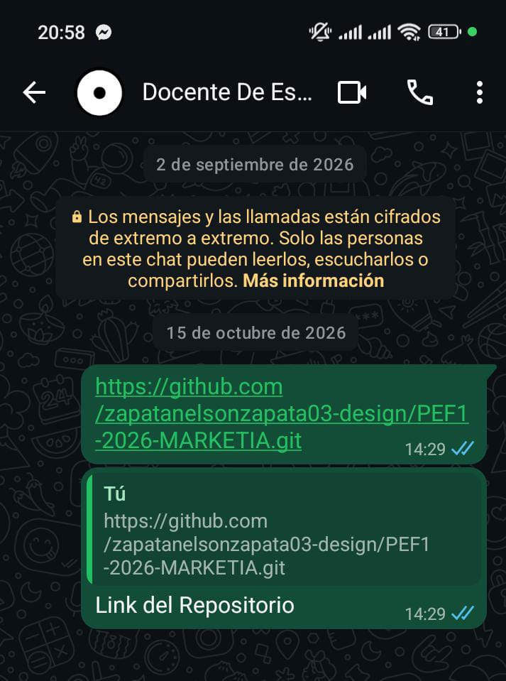
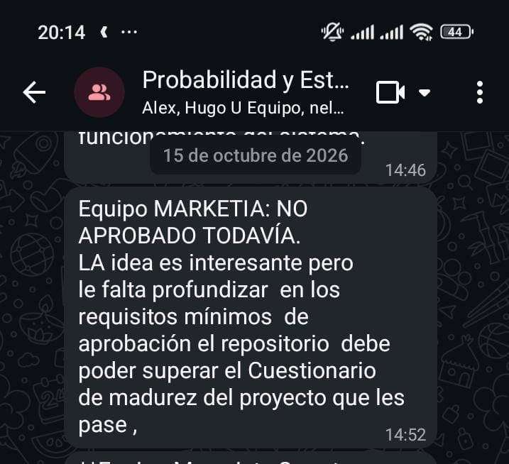

# Solicitud de autorización al docente

> Borrador para enviar por correo o por el medio que indique el docente. Guardar
> aquí la respuesta (captura o texto) con fecha. **No dar por autorizado nada
> que no tenga respuesta escrita.**

**Asunto:** MarketIA: solicitud de autorización de prueba técnica, desarrollo y protocolo de entrevistas

Estimado Ing. Diego Cárdenas:

Somos el equipo de MarketIA (Alex Vásquez Pérez, Nelson Zapata Jiménez y
Cristián García Bustamante). Para avanzar hacia el hito del 24 de octubre le
solicitamos, por favor, su autorización o indicaciones sobre:

1. **Prueba de viabilidad técnica**: probar OmniRoute con 10 ideas de negocio de
   ejemplo (sin datos personales) para medir formato de respuesta, tiempo y
   costo. Se realizará fuera de la carpeta `src/`.
2. **Inicio del desarrollo en `src/`** a partir del 26 de octubre, después de la
   presentación.
3. **Protocolo de entrevistas** a 8 a 10 emprendedores de Cochabamba, con
   consentimiento informado y sin datos personales. Adjuntamos el protocolo y
   el consentimiento (`docs/07-evidencias/`).
4. **Materia**: el cuestionario de aprobación está titulado "Programación II -
   P2" y nuestro informe indica "Probabilidad y Estadística". ¿A cuál debe
   corresponder el proyecto en los documentos?

Repositorio: https://github.com/zapatanelsonzapata03-design/PEF1-2026-MARKETIA

Quedamos atentos. Muchas gracias.

## Respuesta del docente
| Fecha | Medio | Respuesta (texto o captura) |
|---|---|---|
| 15/10/2026, 14:29 | WhatsApp, chat individual con el docente | Envío del enlace del repositorio.  |
| 15/10/2026, 14:52 | WhatsApp, grupo de la materia | "Equipo MARKETIA: NO APROBADO TODAVÍA. La idea es interesante pero le falta profundizar en los requisitos mínimos de aprobación; el repositorio debe poder superar el Cuestionario de madurez del proyecto que les pase"  |
